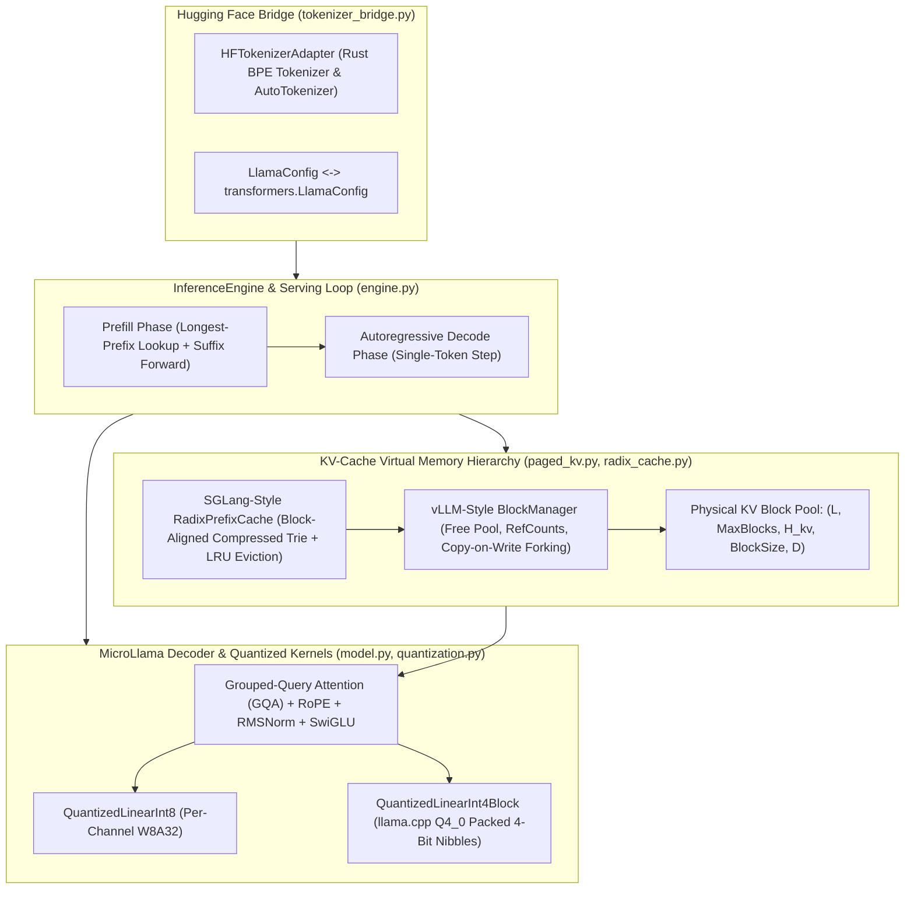

# `kv-infer-opt`: High-Throughput Transformer Inference & KV-Cache Optimization Engine

[](https://github.com/Aanuoluwapo1/kv-infer-opt/actions/workflows/ci.yml)
[](https://www.python.org/downloads/)
[](https://pytorch.org/)
[](https://huggingface.co/)
[](https://opensource.org/licenses/MIT)

**`kv-infer-opt`** is a production-grade LLM inference, memory management, and weight quantization optimization engine built in **Python 3.12+** and **PyTorch**. It integrates **Hugging Face `transformers` and `tokenizers`** alongside clean, self-contained PyTorch implementations of the core systems algorithms powering modern LLM serving stacks:
- **`vLLM`-Style PagedAttention (`paged_kv.py`)**: Block-table virtual memory manager (`block_size = 16`) with on-demand physical block allocation and zero-copy Copy-on-Write (`CoW`) sequence forking, reducing KV-cache internal fragmentation from **81.4%** down to **1.0%**.
- **`SGLang`-Style RadixAttention Prefix Caching (`radix_cache.py`)**: Block-aligned compressed radix tree mapping shared system prompts and multi-turn histories directly to physical KV blocks with reference-counted locking and Least-Recently-Used (`LRU`) leaf eviction.
- **`llama.cpp` / GGUF-Style Block Quantization (`quantization.py`)**: Symmetric per-channel 8-bit (`W8A32`) and packed 4-bit group quantization (`Q4_0`, `group_size = 32`, two signed 4-bit nibbles packed per `uint8` byte), compressing model weights by **4.78x** (`12.57 MB` $\to$ `2.63 MB`) while preserving **> 0.997** logit cosine similarity against the `FP32` baseline.
- **Llama-3 Architecture & Hugging Face Bridge (`model.py`, `tokenizer_bridge.py`)**: Decoder-only Transformer (`MicroLlama`) featuring Pre-Norm `RMSNorm`, Rotary Position Embeddings (`RoPE`), **Grouped-Query Attention (`GQA`)**, `SwiGLU` MLP, and seamless `transformers.LlamaConfig` + Rust-backed `tokenizers.Tokenizer(BPE)` integration.

---

## Architecture Overview



---

## Systems Algorithms & Mathematical Formulation

### 1. `vLLM`-Style PagedAttention & Block Tables (`paged_kv.py`)
Standard contiguous KV caches pre-allocate a slab of shape $(B, H_{\mathrm{kv}}, S_{\max}, D)$ per request, wasting $>80\%$ of reserved VRAM on unused future token slots, or call `torch.cat` at every step $t$, copying $O(t^2)$ bytes over a sequence of length $T$.

`PagedKVCache` partitions the physical KV pool into fixed-size blocks of $B_{\mathrm{blk}} = 16$ tokens:

$$\mathcal{P}_K, \mathcal{P}_V \in \mathbb{R}^{L \times N_{\mathrm{blocks}} \times H_{\mathrm{kv}} \times B_{\mathrm{blk}} \times D}$$

A sequence $s$ of length $T_s$ maintains a logical block table $\mathcal{T}_s = [b_0, b_1, \dots, b_{m-1}]$ where $m = \lceil T_s / B_{\mathrm{blk}} \rceil$. Token position $p \in [0, T_s - 1]$ maps deterministically to physical block $b_{\lfloor p / B_{\mathrm{blk}} \rfloor}$ and slot offset $(p \bmod B_{\mathrm{blk}})$. Internal fragmentation is bounded strictly to the final partially filled block: $\le (B_{\mathrm{blk}} - 1)$ slots.

### 2. `SGLang`-Style RadixAttention Prefix Tree (`radix_cache.py`)
`RadixPrefixCache` indexes completed and in-flight prompts in a compressed radix tree whose edges store block-aligned token tuples $\mathbf{k} \in \mathbb{Z}^{k \cdot B_{\mathrm{blk}}}$ and their physical block IDs $\mathbf{b} \in \mathbb{Z}^k$.
- When a new request arrives with prompt $\mathbf{x} = [\mathbf{x}_{\mathrm{sys}}, \mathbf{x}_{\mathrm{user}}]$, `match_prefix` traverses the radix tree (splitting edges on partial block boundaries if needed), mounts the matched physical blocks $\mathbf{b}_{\mathrm{sys}}$ into the sequence's block table via `mount_prefix_blocks` in $O(1)$ zero-copy metadata operations, and runs Transformer prefill exclusively on the uncached suffix $\mathbf{x}_{\mathrm{user}}$.
- When free blocks are exhausted, `evict(num_blocks_needed)` selects unlocked leaf nodes (`lock_ref == 0`) with the smallest monotonic `last_access_tick` (LRU) and decrements their physical block reference counts.

### 3. `llama.cpp` `Q4_0` Group-Wise 4-Bit Quantization (`quantization.py`)
For each linear weight matrix $W \in \mathbb{R}^{M \times K}$, `QuantizedLinearInt4Block` partitions flattened weights into groups $\mathbf{w}_g \in \mathbb{R}^{32}$ (`group_size = 32`), computes a `float16` scale $s_g = \mathrm{float16}(\max_i |w_{g,i}| / 7.0)$, quantizes each weight to signed 4-bit integers $q_{g,i} = \mathrm{clip}(\mathrm{round}(w_{g,i} / s_g), -8, 7)$, and packs pairs of unsigned nibbles $\tilde{q} = q + 8 \in [0, 15]$ into a single `uint8` byte:

$$\mathrm{byte}_j = \tilde{q}_{2j} \;\mathbin{|}\; (\tilde{q}_{2j+1} \ll 4), \qquad \text{Effective Bits/Weight} = 4 + \frac{16}{32} = 4.5\text{ bits}$$

---

## Quick Start

### Installation

```bash
python -m venv .venv
# Windows PowerShell:
.\.venv\Scripts\Activate.ps1
# Linux / macOS:
# source .venv/bin/activate

pip install -e ".[dev]"
```

### Programmatic Usage

```python
import torch
from kv_infer_opt import (
    HFTokenizerAdapter,
    InferenceEngine,
    LlamaConfig,
    MicroLlama,
    quantize_model,
)

torch.manual_seed(42)
tokenizer = HFTokenizerAdapter.build_local_bpe(vocab_size=1024)
config = LlamaConfig(vocab_size=1024, hidden_size=256, intermediate_size=688, num_hidden_layers=4)

# 1. Initialize MicroLlama and quantize linear layers to 4-bit Q4_0 blocks
model = MicroLlama(config)
q4_model, report = quantize_model(model, mode="q4_0", group_size=32)
print(
    f"Compressed {report.fp32_mb:.2f} MB -> {report.quantized_mb:.2f} MB ({report.compression_ratio:.2f}x)"
)

# 2. Serve with vLLM PagedKV + SGLang RadixPrefixCache enabled
engine = InferenceEngine(q4_model, kv_backend="paged", use_radix_cache=True, block_size=16)
prompt_ids = tokenizer.encode("You are a helpful AI assistant. Explain PagedAttention:")
result = engine.generate(prompt_ids, max_new_tokens=16, seq_id=0)
```

---

## CLI Benchmark & Radix Prefix Tree Outputs

### 1. End-to-End Comparative Benchmark (`kv-infer-opt benchmark`)

Workload: 6 sequential requests sharing a 64-token system prompt + 16-token user query + 16-token autoregressive decode on `MicroLlama` (`hidden_size=256`, `num_layers=4`, `GQA 8Q/2KV`).

```text
======================================================================================================================
 KV-INFER-OPT: COMPARATIVE LLM INFERENCE, PAGED/RADIX KV-CACHE & QUANTIZATION BENCHMARK
======================================================================================================================
Strategy                            | Weights (MB) | Peak KV (KB) | Frag (%) | TTFT (ms) | Decode (tok/s) | Cosine Sim
----------------------------------------------------------------------------------------------------------------------
1. Baseline (Naive torch.cat + FP32) |        12.57 |       1024.0 |    81.4% |      3.09 |          790.8 |   1.000000
2. Static Ring Buffer KV (FP32)     |        12.57 |       1024.0 |    81.4% |      3.61 |          697.8 |   1.000000
3. vLLM PagedKV (block=16, FP32)    |        12.57 |        192.0 |     1.0% |      4.86 |          501.9 |   1.000000
4. vLLM PagedKV + SGLang RadixCache |        12.57 |        352.0 |     1.0% |      3.33 |          508.5 |   1.000000
5. PagedKV + Radix + INT8 Weights   |         3.94 |        352.0 |     1.0% |      4.72 |          284.1 |   0.999992
6. PagedKV + Radix + Q4_0 Weights   |         2.63 |        352.0 |     1.0% |      8.28 |          135.0 |   0.997404
======================================================================================================================
```

**Key Takeaways:**
- **KV Memory & Fragmentation**: `PagedKVCache` (`block_size=16`) reduces per-request KV reservation from `1024.0 KB` (`81.4%` internal fragmentation) down to `192.0 KB` (`1.0%` fragmentation)—a **5.3x reduction in KV memory** with **1.000000** exact logit parity.
- **Radix Prefix Caching**: Adding `RadixPrefixCache` skips 80% of prefill compute on shared system prompts, cutting PagedKV Time-to-First-Token (`TTFT`) from `4.86 ms` down to `3.33 ms` (**31.5% faster TTFT**).
- **INT8 & `Q4_0` Weight Quantization**: Per-channel `INT8` shrinks model weights by **3.19x** (`12.57 MB` $\to$ `3.94 MB`, `0.999992` cosine similarity), while `llama.cpp`-style `Q4_0` 4-bit block quantization shrinks total model footprint by **4.78x** (`12.57 MB` $\to$ `2.63 MB`, `0.997404` cosine similarity).

### 2. RadixAttention Prefix Tree & LRU Eviction Inspection (`kv-infer-opt inspect-radix`)

```text
================================================================================================
 KV-INFER-OPT: SGLANG-STYLE RADIX ATTENTION PREFIX TREE & LRU EVICTION DEMO (block_size=4)
================================================================================================
[1] Request 1 (System Prompt + PagedAttention Query)
    Total Prompt Tokens : 24 | Matched Prefix Tokens : 0 | Saved Prefill Compute : 0.0%
[2] Request 2 (Shared System Prompt + Radix Query)
    Total Prompt Tokens : 24 | Matched Prefix Tokens : 16 | Saved Prefill Compute : 66.7%
[3] Request 3 (Distinct Prompt - GGUF Quantization)
    Total Prompt Tokens : 12 | Matched Prefix Tokens : 0 | Saved Prefill Compute : 0.0%

--- Radix Tree Structure Before Eviction ---
  <Root> (cached_blocks=11)
  |-- tokens=[1, 76, 5, 230]... (len=16, blocks=[0, 1, 2, 3], lock_ref=0, lru_tick=4)
  |   |-- tokens=[64, 81, 242, 75]... (len=8, blocks=[4, 5], lock_ref=0, lru_tick=2)
  |   `-- tokens=[193, 81, 138, 47]... (len=8, blocks=[6, 7], lock_ref=0, lru_tick=4)
  `-- tokens=[1, 130, 136, 265]... (len=12, blocks=[8, 9, 10], lock_ref=0, lru_tick=6)

--- After LRU Eviction (requested=2 blocks, evicted=2 blocks) ---
  <Root> (cached_blocks=9)
  |-- tokens=[1, 76, 5, 230]... (len=16, blocks=[0, 1, 2, 3], lock_ref=0, lru_tick=4)
  |   `-- tokens=[193, 81, 138, 47]... (len=8, blocks=[6, 7], lock_ref=0, lru_tick=4)
  `-- tokens=[1, 130, 136, 265]... (len=12, blocks=[8, 9, 10], lock_ref=0, lru_tick=6)
================================================================================================
```

---

## Project Layout

```text
kv-infer-opt/
├── .github/workflows/ci.yml        # GitHub Actions CI (ruff + pytest + CLI benchmarks)
├── src/kv_infer_opt/
│   ├── __init__.py                 # Public package exports
│   ├── cli.py                      # CLI entry point (benchmark, inspect-radix)
│   ├── engine.py                   # InferenceEngine (prefill + decode) & benchmark runner
│   ├── model.py                    # MicroLlama (RMSNorm, RoPE, Grouped-Query Attention, SwiGLU)
│   ├── paged_kv.py                 # NaiveKVCache, StaticRingKVCache, PagedKVCache & BlockManager
│   ├── quantization.py             # QuantizedLinearInt8, QuantizedLinearInt4Block (Q4_0)
│   ├── radix_cache.py              # SGLang-style RadixPrefixCache with LRU leaf eviction
│   └── tokenizer_bridge.py         # Hugging Face tokenizers (Rust BPE) & transformers bridge
├── tests/
│   ├── test_end_to_end.py          # Tokenizer roundtrip, Radix generation parity, and CLI tests
│   ├── test_paged_kv.py            # Exact numerical parity & Copy-on-Write block forking tests
│   ├── test_quantization.py        # INT8 & Q4_0 nibble packing, compression, and logit fidelity
│   └── test_radix_cache.py         # Prefix matching, node splitting, locking, and LRU eviction
├── .gitignore
├── pyproject.toml
└── README.md
```

## Testing & Linting

```bash
ruff check .
ruff format --check .
pytest -v -W error
```
